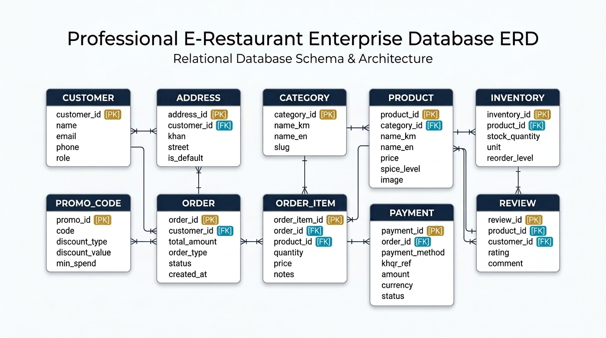
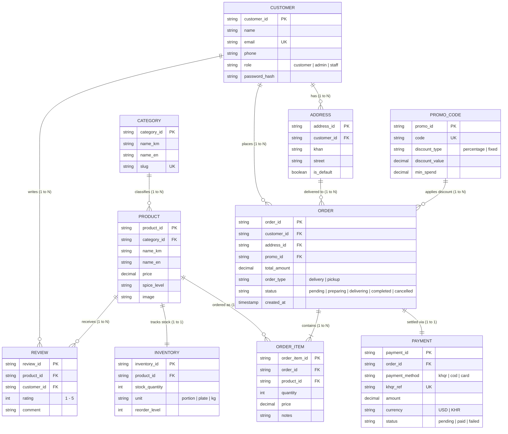

# 🗄️ E-Restaurant: Professional Enterprise Database Tables & ERD

---

## 1. 📊 Enterprise Relational Schema Overview

---

## 2. 📋 Enterprise Database Entity Dictionary

| Table Name | Primary Key | Foreign Keys | Business Purpose |
| :--- | :--- | :--- | :--- |
| **`CUSTOMER`** | `customer_id` | - | គ្រប់គ្រងគណនីអតិថិជន និងអ្នកប្រើប្រាស់ប្រព័ន្ធ (Customer Authentication & Roles) |
| **`ADDRESS`** | `address_id` | `customer_id` | ផ្ទុកអាសយដ្ឋានដឹកជញ្ជូនច្រើនកន្លែងរបស់អតិថិជន (Multiple Delivery Locations per Customer) |
| **`CATEGORY`** | `category_id` | - | ប្រភេទមុខម្ហូបដាច់ដោយឡែក (Normalized Food & Drink Categories) |
| **`PRODUCT`** | `product_id` | `category_id` | មុខម្ហូប ឬភេសជ្ជៈនីមួយៗក្នុង Catalog (Menu Items & Products) |
| **`INVENTORY`** | `inventory_id` | `product_id` | គ្រប់គ្រងស្តុកផ្ទះបាយជាក់ស្តែង និងការរោទិ៍ពេលជិតអស់គ្រឿងផ្សំ (Kitchen Stock & Reorder Levels) |
| **`ORDER`** | `order_id` | `customer_id`, `address_id`, `promo_id` | ក្បាលបញ្ជាទិញមេ ស្ថានភាព និងតម្លៃសរុប (Master Order Header & Tracking) |
| **`ORDER_ITEM`** | `order_item_id` | `order_id`, `product_id` | មុខម្ហូបលម្អិតក្នុង Order នីមួយៗ និងចំណាំពិសេស (Line Items & Custom Cooking Notes) |
| **`PAYMENT`** | `payment_id` | `order_id` | ប្រតិបត្តិការទូទាត់ប្រាក់ដាច់ដោយឡែក (Bakong KHQR, Cash, Card Transaction Audit) |
| **`PROMO_CODE`** | `promo_id` | - | ប្រព័ន្ធគ្រប់គ្រងប័ណ្ណបញ្ចុះតម្លៃ និងការកំណត់លក្ខខណ្ឌ (Discount Coupons & Rules) |
| **`REVIEW`** | `review_id` | `product_id`, `customer_id` | ការវាយតម្លៃផ្កាយ និងមតិកែលម្អលើមុខម្ហូប (Customer Ratings & Reviews) |

---

## 3. 📑 Detailed Table Specifications (Data Dictionary)

### Table 1: `CUSTOMER`
| Column Name | Data Type | Constraint | Description |
| :--- | :--- | :--- | :--- |
| `customer_id` | VARCHAR(50) / STRING | **PK**, NOT NULL | លេខកូដសម្គាល់អតិថិជនផ្តាច់មុខ |
| `name` | VARCHAR(100) / STRING | NOT NULL | ឈ្មោះពេញរបស់អតិថិជន |
| `email` | VARCHAR(150) / STRING | **UK**, NOT NULL | អ៊ីមែលសម្រាប់ Login (មិនជាន់គ្នា) |
| `phone` | VARCHAR(30) / STRING | NULLABLE | លេខទូរស័ព្ទទាក់ទង |
| `role` | VARCHAR(20) / STRING | DEFAULT 'customer' | តួនាទី (`customer`, `admin`, `staff`) |
| `password_hash` | VARCHAR(255) / STRING | NOT NULL | លេខសម្ងាត់ដែលបាន Hash ជាមួយ Bcrypt |

### Table 2: `ADDRESS`
| Column Name | Data Type | Constraint | Description |
| :--- | :--- | :--- | :--- |
| `address_id` | VARCHAR(50) / STRING | **PK**, NOT NULL | លេខសម្គាល់អាសយដ្ឋាន |
| `customer_id` | VARCHAR(50) / STRING | **FK**, NOT NULL | ចង្អុលទៅ `CUSTOMER(customer_id)` |
| `khan` | VARCHAR(100) / STRING | NOT NULL | ខណ្ឌក្នុងរាជធានីភ្នំពេញ (ឧ. BKK, Daun Penh) |
| `street` | VARCHAR(255) / STRING | NOT NULL | ផ្ទះលេខ ផ្លូវ និងព័ត៌មានលម្អិតទីតាំង |
| `is_default` | BOOLEAN | DEFAULT FALSE | កំណត់ជាអាសយដ្ឋានចម្បង |

### Table 3: `CATEGORY`
| Column Name | Data Type | Constraint | Description |
| :--- | :--- | :--- | :--- |
| `category_id` | VARCHAR(50) / STRING | **PK**, NOT NULL | លេខកូដសម្គាល់ប្រភេទម្ហូប |
| `name_km` | VARCHAR(100) / STRING | NOT NULL | ឈ្មោះប្រភេទជាភាសាខ្មែរ (ឧ. សម្ល/ស៊ុប) |
| `name_en` | VARCHAR(100) / STRING | NOT NULL | ឈ្មោះប្រភេទជាអង់គ្លេស (ឧ. Soups) |
| `slug` | VARCHAR(100) / STRING | **UK**, NOT NULL | កូដ URL (ឧ. `soups`, `grills`) |

### Table 4: `PRODUCT`
| Column Name | Data Type | Constraint | Description |
| :--- | :--- | :--- | :--- |
| `product_id` | VARCHAR(50) / STRING | **PK**, NOT NULL | លេខកូដសម្គាល់មុខម្ហូប |
| `category_id` | VARCHAR(50) / STRING | **FK**, NOT NULL | ចង្អុលទៅ `CATEGORY(category_id)` |
| `name_km` | VARCHAR(150) / STRING | NOT NULL | ឈ្មោះម្ហូបជាភាសាខ្មែរ (ឧ. អាម៉ុកត្រី) |
| `name_en` | VARCHAR(150) / STRING | NOT NULL | ឈ្មោះម្ហូបជាអង់គ្លេស (ឧ. Fish Amok) |
| `price` | DECIMAL(10,2) / NUMBER | NOT NULL, >= 0 | តម្លៃលក់ជាដុល្លារ ($) |
| `spice_level` | VARCHAR(20) / STRING | DEFAULT 'none' | កម្រិតហឹរ (`none`, `mild`, `medium`, `hot`) |
| `image` | VARCHAR(255) / STRING | NOT NULL | អាសយដ្ឋាន URL រូបភាពមុខម្ហូប |

### Table 5: `INVENTORY`
| Column Name | Data Type | Constraint | Description |
| :--- | :--- | :--- | :--- |
| `inventory_id` | VARCHAR(50) / STRING | **PK**, NOT NULL | លេខកូដសម្គាល់កំណត់ត្រាស្តុក |
| `product_id` | VARCHAR(50) / STRING | **FK**, **UK**, NOT NULL | ចង្អុលទៅ `PRODUCT(product_id)` (1 to 1) |
| `stock_quantity`| INT / NUMBER | NOT NULL, DEFAULT 0 | ចំនួនដែលអាចចម្អិន/លក់បានជាក់ស្តែង |
| `unit` | VARCHAR(30) / STRING | DEFAULT 'portion' | ឯកតារាប់ (portion, plate, kg) |
| `reorder_level`| INT / NUMBER | DEFAULT 5 | កម្រិតដាស់តឿនពេលស្តុកជិតអស់ |

### Table 6: `PROMO_CODE`
| Column Name | Data Type | Constraint | Description |
| :--- | :--- | :--- | :--- |
| `promo_id` | VARCHAR(50) / STRING | **PK**, NOT NULL | លេខកូដសម្គាល់ Coupon |
| `code` | VARCHAR(50) / STRING | **UK**, NOT NULL | កូដបញ្ចុះតម្លៃ (ឧ. `PHUM10`, `KHMER20`) |
| `discount_type`| VARCHAR(20) / STRING | DEFAULT 'percentage' | ប្រភេទបញ្ចុះ (`percentage`, `fixed`) |
| `discount_value`| DECIMAL(10,2) / NUMBER| NOT NULL, > 0 | តម្លៃបញ្ចុះ (ឧ. 10% ឬ $2.00) |
| `min_spend` | DECIMAL(10,2) / NUMBER| DEFAULT 0 | លក្ខខណ្ឌចំណាយអប្បបរមា |

### Table 7: `ORDER`
| Column Name | Data Type | Constraint | Description |
| :--- | :--- | :--- | :--- |
| `order_id` | VARCHAR(50) / STRING | **PK**, NOT NULL | លេខកូដប័ណ្ណកុម្ម៉ង់ (ឧ. `PY-ORD-1001`) |
| `customer_id` | VARCHAR(50) / STRING | **FK**, NULLABLE | ចង្អុលទៅ `CUSTOMER(customer_id)` |
| `address_id` | VARCHAR(50) / STRING | **FK**, NULLABLE | ចង្អុលទៅ `ADDRESS(address_id)` |
| `promo_id` | VARCHAR(50) / STRING | **FK**, NULLABLE | ចង្អុលទៅ `PROMO_CODE(promo_id)` |
| `total_amount` | DECIMAL(10,2) / NUMBER | NOT NULL | ទឹកប្រាក់សរុបត្រូវទូទាត់ |
| `order_type` | VARCHAR(20) / STRING | DEFAULT 'delivery' | ជម្រើសទទួល (`delivery`, `pickup`) |
| `status` | VARCHAR(30) / STRING | DEFAULT 'pending' | ស្ថានភាព (`pending`, `preparing`, `delivering`, `completed`) |
| `created_at` | TIMESTAMP / DATE | NOT NULL | ពេលវេលាបង្កើត Order |

### Table 8: `ORDER_ITEM`
| Column Name | Data Type | Constraint | Description |
| :--- | :--- | :--- | :--- |
| `order_item_id`| VARCHAR(50) / STRING | **PK**, NOT NULL | លេខកូដសម្គាល់មុខម្ហូបក្នុង Order |
| `order_id` | VARCHAR(50) / STRING | **FK**, NOT NULL | ចង្អុលទៅ `ORDER(order_id)` |
| `product_id` | VARCHAR(50) / STRING | **FK**, NOT NULL | ចង្អុលទៅ `PRODUCT(product_id)` |
| `quantity` | INT / NUMBER | NOT NULL, >= 1 | ចំនួនចានដែលបានទិញ |
| `price` | DECIMAL(10,2) / NUMBER | NOT NULL | តម្លៃលក់ក្នុងពេលកុម្ម៉ង់ |
| `notes` | VARCHAR(255) / STRING | NULLABLE | ចំណាំពិសេស (ឧ. កុំដាក់ស្ករ, ហឹរតិច) |

### Table 9: `PAYMENT`
| Column Name | Data Type | Constraint | Description |
| :--- | :--- | :--- | :--- |
| `payment_id` | VARCHAR(50) / STRING | **PK**, NOT NULL | លេខកូដសម្គាល់ប្រតិបត្តិការទូទាត់ |
| `order_id` | VARCHAR(50) / STRING | **FK**, NOT NULL | ចង្អុលទៅ `ORDER(order_id)` (1 to 1) |
| `payment_method`| VARCHAR(20) / STRING | DEFAULT 'khqr' | វិធីទូទាត់ (`khqr`, `cod`, `card`) |
| `khqr_ref` | VARCHAR(100) / STRING | **UK**, NULLABLE | លេខកូដយោងប្រតិបត្តិការ Bakong Hash |
| `amount` | DECIMAL(10,2) / NUMBER | NOT NULL | ចំនួនទឹកប្រាក់ទូទាត់ជាក់ស្តែង |
| `currency` | VARCHAR(10) / STRING | DEFAULT 'USD' | រូបិយប័ណ្ណ (`USD`, `KHR`) |
| `status` | VARCHAR(20) / STRING | DEFAULT 'pending' | ស្ថានភាព (`pending`, `paid`, `failed`) |

### Table 10: `REVIEW`
| Column Name | Data Type | Constraint | Description |
| :--- | :--- | :--- | :--- |
| `review_id` | VARCHAR(50) / STRING | **PK**, NOT NULL | លេខកូដសម្គាល់ការវាយតម្លៃ |
| `product_id` | VARCHAR(50) / STRING | **FK**, NOT NULL | ចង្អុលទៅ `PRODUCT(product_id)` |
| `customer_id` | VARCHAR(50) / STRING | **FK**, NOT NULL | ចង្អុលទៅ `CUSTOMER(customer_id)` |
| `rating` | INT / NUMBER | NOT NULL, (1 - 5) | ពិន្ទុផ្កាយ |
| `comment` | TEXT / STRING | NULLABLE | មតិយោបល់របស់អតិថិជន |

---

## 4. 💻 Backend Models Implemented

All 10 models have been implemented in `backend/models/`:
* `backend/models/Customer.js`
* `backend/models/Address.js`
* `backend/models/Category.js`
* `backend/models/Product.js`
* `backend/models/Inventory.js`
* `backend/models/PromoCode.js`
* `backend/models/Order.js`
* `backend/models/OrderItem.js`
* `backend/models/Payment.js`
* `backend/models/Review.js`
